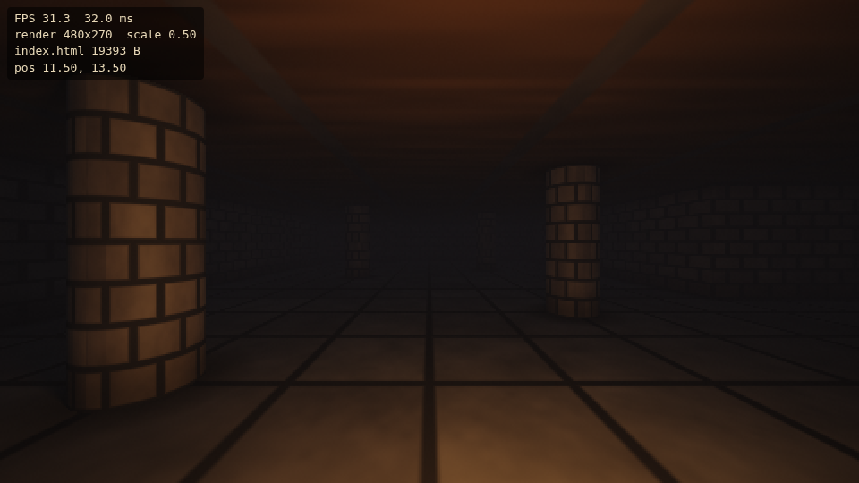

# Shader Dungeon

A tiny torch-lit dungeon in **one self-contained `index.html`** (~19 KB, limit 50 KB).
No build step, no dependencies. All rendering happens in **one WebGL2 fragment shader**;
JavaScript only handles input, collisions and uniforms.



## Play

- Open `index.html` directly in a desktop browser with WebGL2 (Chrome, Edge, Firefox), or serve it:
  `python3 -m http.server 8000` then open http://localhost:8000/
- Click to start (pointer lock). `WASD` move, mouse look, `←` `→` turn, `Shift` run.
- Goal: find the glowing rune (exit) in the far corner of the map.

URL options:

| Option | Effect |
| --- | --- |
| `?scale=auto` (default) | adaptive render resolution (0.3–1.0) targeting ~40–60 FPS |
| `?scale=0.5` | fixed render scale (0.1–2); the canvas is upscaled with nearest filtering |
| `?x=11.5&z=13.5&yaw=1.57&pitch=0` | start pose (useful for comparable screenshots) |

The HUD shows FPS, frame time, render resolution, scale and the byte size of `index.html`.

## How the shader is organised

The vertex shader emits a single fullscreen triangle (`gl_VertexID`, no buffers).
The fragment shader does, per pixel:

1. **Camera ray** from `uCam` (position) and `uLook` (yaw, pitch).
2. **Floor / ceiling**: analytic plane intersection (`y = 0`, `y = 1`).
3. **Walls**: `traceGrid()`, a DDA traversal of the map grid in xz, stopped at the plane
   distance. Full-height boxes need no y test, so a hit is exact and costs only the cells
   crossed. Pillars get an analytic ray/circle test inside their cell.
4. **Materials**: procedural brick (running bond, mortar mask, per-brick tint, moss on `M`
   walls), flagstone floor, ceiling with beams, exit rune with animated emission.
5. **SDF of the grid**: `sdWalls()` evaluates boxes/pillars in the 3x3 neighbourhood of the
   current cell (grid-repeated boxes). Used for:
   - **soft shadows** (`softShadow()`, sphere tracing towards the torch, penumbra `k·h/t`),
   - **contact AO** on floor and ceiling.
6. **Lighting**: torch point light (`uTorch`, held in the right hand, bobbing) with flicker
   (`uFlick`, computed in JS), inverse-square-ish attenuation, Lambert + small Blinn specular;
   a shadowless cyan light at the exit so the goal reads from afar; tiny cold ambient.
7. **Post**: exponential distance fog, ACES-fit tone mapping, vignette, gamma, dither.

The map is a string array at the top of the script. It is uploaded as an `R8UI` texture
(`texelFetch`, codes: 0 floor, 1 brick, 2 moss, 3 pillar, 4 exit) and the same array drives
circle-vs-cell collisions in JS, so what you see is what you collide with.

## Test

```
node scripts/smoke.mjs                # SMOKE_SCALE=1 / auto / 0.25, SMOKE_PORT=8765
```

The smoke test serves the folder with `python3 -m http.server`, loads the page in headless
Chromium (SwiftShader WebGL2), fails on page or console errors and on blank frames, walks
into a wall (collision), turns and walks down a corridor, walks onto the exit (win screen),
and writes screenshots to `shots/` (gitignored). Playwright must be reachable from Node
(global install or npx cache); it is not a project dependency.

Measured in headless SwiftShader (CPU software rasterizer, 960x540 viewport), so real GPUs
will be much faster:

| Render scale | Resolution | FPS |
| --- | --- | --- |
| 1.0 | 960x540 | ~11 |
| 0.5 | 480x270 | ~37–46 |
| auto | settled at 0.39 (376x211) | ~56 |
| 0.25 | 240x135 | 60 (vsync cap) |

## Scope

In: hardcoded grid map, raymarched/DDA walls, torch light with flicker and soft shadows,
fog, WASD + mouse with grid collisions, FPS and file size HUD, adaptive resolution.

Out (on purpose): enemies, combat, inventory, procedural levels, audio, WebGPU, mobile.
